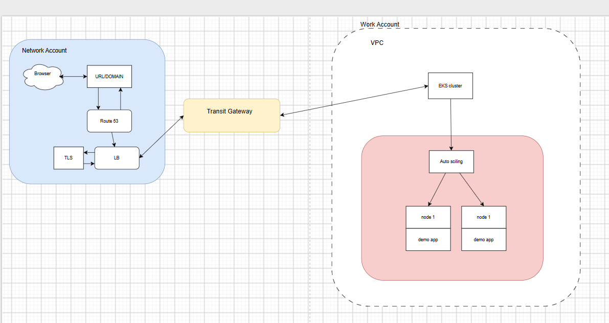

# Part 4 – Deploying Inside an AWS Landing Zone

## 1. Research - Landing Zone

1.A -Landing Zone is a multi-account AWS environment designed for scalable baseline for deploying workloads. Rather than running everything in a single AWS account or manually configuring security networking, and billing for each new project a landing zone establishes standardized guardrails and account structures upfront.

1.B - Account types would you expect to find  are *Management * , *Security* , *Shared Services* , * Experimentation* , *Sandbox (to fix bugs)* 

Management account - he root account that creates the AWS Organization, manages consolidated billing, applies Service Control Policies (SCPs), and provisions new member accounts

Security account - divide to Log Archive & Security Tool . *Log Archive* is where all the logs and the config file are stored for every a account . *Security Tool* Acts as the delegated administrator for organization  giving  the security team services—such as Amazon GuardDuty, AWS Security Hub, and IAM Access Analyzer—giving security teams centralized visibility.

Shared Services account- Managed by central platform or networking teams to provide shared Services across the organization such as Gateway , Firewall , egress , ingress ,VPCs . VPN , golden image , CI/CD, monitoring services and containers registries 

Experimentation account/Sandbox accoun- Working account for testing different environment such as QA , DEV ,PROD or testing bugs in the system

1.C - For the research of the landing zone i use AI such as gemini & grokbot and to conform it i look in the AWS website "https://docs.aws.amazon.com/prescriptive-guidance/latest/strategy-migration/aws-landing-zone.html"

Typical accounts:
- **Management** – Organizations, billing, Control Tower
- **Log Archive** – centralized CloudTrail / Config logs
- **Security / Audit** – security tooling and findings
- **Network** – Transit Gateway, shared ingress/egress, CloudFront, WAF
- **Shared Services** – CI/CD runners, artifact repositories
- **Workload** – one (or more) per application or team

Sources: AWS Control Tower docs, Landing Zone Accelerator, AWS multi-account whitepaper.

## 2. Placement Diagram (Scenario)

*diagram *

Request Flow
The user navigates to [https://demoapp.com](https://demoapp.com).

Route 53 routes the request to the Load Balancer in the Network Account.

The LB terminates TLS and forwards the request through the Transit Gateway.

The request reaches the EKS Cluster in the Workload Account.

It arrives at a Pod running on one of the Nodes.

**Assumptions:**
- DNS for `demoapp.com` lives in the Network account (or is delegated).
- TLS certificate is on the shared ALB / CloudFront (ACM in Network account).
- The workload VPC has only private subnets; internet egress goes through the Transit Gateway to a centralized NAT in the Network account.
- CI/CD runs in the Shared Services account and assumes a role into the Workload account.

## 3. Network Changes vs Part 1
In Part 1 I created a VPC with: Public and Private subnets ,Internet Gateway,NAT Gateway and Nodes in private subnets (with outbound internet access via NAT)
In the Landing Zone the VPC I was given has:Private subnets only ,No IG ,no local NAT gateway and the outbound internet access only through the gateway

things that i w=would change in my IAC
1) Remove Public Subnets and Internet Gateway because All traffic goes through the Transit Gateway and there is no direct internet exposure
2) Remove the NAT Gateway because egress is managed IN THE network account and its not neccessary also add the cost to the system
3) Disable Public IPs on Nodes. Nodes do not need a public IP address it will add an opening  for an attack on the cluster
4) Add VPC Endpoints for ECR and S3 for pull images without going out to the internet
5) Change the CIDR to avoid overlap in other accounts

## 3 Bonus – Implement Two of Them
1) I will add to the EKS.tf file  in the managed node groups a `associate_public_ip_address = false`
2) I will add a file for the S3 bucket with `aws_vpc_endpoint` to connet to the s3 privitly and i will add a `aws_security_group` for the s3 bucket with permission for nodes to pull images in privit way

## 4. Guardrails - Missing Tag

The three required tags (`environment`, `owner`, `cost_center`) are already applied in my tf code .

If a resource is missing a tag, the pipeline as usual but it will brake because the AWS will return a TagPolicyViolation error then the terraform apply will fail and the environment will stay the same 

I would add `Checkov` in the pipeline *before* `terraform apply` to catch missing tags and other misconfigurations early.

## 5. FinOps

| Resource | Estimated monthly cost (us-east-1) |
|----------|------------------------------------|
| EKS control plane | ~$73 |
| 2× t3.medium nodes | ~$60 |
| NAT Gateway | ~$32 + data |
| ALB | ~$22 |
| **Total** | **~$190–220** |

**Cost cuts for dev:**
1. change instances (ec2) for nodes it will save ~70% in instances cost
2. scale to 0 outside working hours the instances will not run there for you will not pay for the instances
3. Delete the environment when idle the cluster will not run there 

I would not use change or scale-to-zero in production availability will go down . 
I will at tags let finance filter costs by team to monitor the Cost . 
or skile down the instances for lest cost ec2 if the load allows it 

The tags will help the team see how much it is spending and it will be easy to spot. also we can set a budgets alert to know it we went over budget 

## 6. Pipeline Credentials

In the Workload Account, you create an IAM Role with a trust policy that allows GitHub Actions to OIDC to assume the role.
in GitHub, the workflow uses aws credentials with role at was assume to it instead of Access Keys then the GitHub sends a token to the aws and AWS returns temporary credentials 
the credentials live for one hour in not change 

i will set minimum permissions: EKS, EC2, IAM , Route53, ACM, and Helm-related actions.

